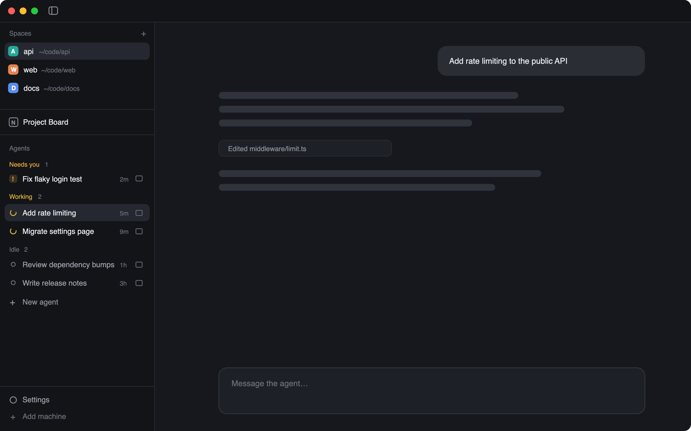

# Agents sidebar

One sidebar for everything: spaces on top, the active space's agents below, and the selected agent's
chat (or terminal) filling the rest of the window. No tab bar, status bar or side panels. The sidebar
collapses to a 46px icon rail; hovering the rail opens the full sidebar over the work area, growing out
of the rail with its labels fading in, and closes when the pointer leaves.



## What you see

Top to bottom, left to right:

- **Title bar** (42px, the full window width, the theme's `chrome` with a 1px `border` line under it):
  room for the macOS traffic lights, then a sidebar toggle (the `workspace-chrome/sidebar.svg` icon,
  26px hit area, `muted`). Dragging the bar moves the window.
- **Sidebar** (268px by default, 160–480px expanded, 46px collapsed; `chrome` background; a 1px `border`
  line on its right edge). Two panels split horizontally, then a footer:
  - **Spaces.** A "Spaces" label (11.5px, `dim`) with a + button pinned 10px from the right. One 30px row
    per space: an 18px rounded avatar in the space's color with its initial, the name (13px,
    `foreground`), then where the space is now (11.5px, `dim`, `~` for home). The active space's row has
    the `selected` background. Squeezed below 72px tall, the panel becomes a single dropdown row: the
    active space's avatar, name and folder, and a chevron.
  - **Agents.** At the top, items other mods register (an icon and a title, 30px rows), then a line.
    Under an "Agents" label, the active space's agents in priority sections: Needs you (`blocked`),
    Done (`done`), Working (`working`), Idle (`dim`), each with a count. A row (30px) is the status
    indicator in a 14px column on the left, the agent's name (filling the width, truncated), how long
    since its state changed (11px, `dim`), and an archive button. Pinned agents come first. Last, a
    "New agent" row with a +.
  - **Footer** (a `border` line above): Settings and Add machine.
- **Work area:** the active tab, unframed. With herdr-chat, a chat tab is the chat itself.
- **Context panel** (optional, per agent): a 340px pane on the right of the agent's tab, opened from the
  title bar's panel button (`workspace-chrome/panel-right.svg`, right of the Open In icons). Tabs across
  the top (36px, `selected` behind the active one, no line under them); once the pane is narrower than
  the tabs' own width, a dropdown instead, switching live as it's resized. `chrome` background, like the
  sidebar, with a 1px `border` line on its left edge.
  The Summary tab: the agent's folder (`folder.svg`, `~` for home) with an Open In button on the right
  (opens opens-in's menu for that folder), and its git branch (`git-branch.svg`) with the change from
  the base branch on the right, `+added` in `ansi2` and `-removed` in `ansi1` (`dim` when 0). Files and
  Changes tabs are Herdr's own Files and Changes panels, on by default. Other mods can add their own tabs, and lines under these two (see
  Registering a panel tab).

Every row keeps its icon in the same 14px column 16px from the sidebar's edge (8px list margin, 8px row
padding), so the rail is the same rows with the labels hidden.

## How it behaves

- **Agent status:** working is a spinning ring (`working`), blocked a `!` badge (`blocked`), done a
  filled dot (`done`), idle an outlined dot. Sub-agents nest under their parent with tree lines; a
  parent's fold chevron shows how many and the most urgent state when folded.
- **Agents:** click a row to show it in the work area. Double-click or right-click renames it in place
  (Enter or clicking away saves, Escape cancels, empty goes back to the automatic name). Archive settles
  its tab: it leaves the list but keeps running, and comes back when it needs you. An agent in a linked git worktree also has its leftovers committed
  ("Clean up commit"), its branch pushed to origin, then the worktree and local branch removed (kept
  if another tab is still in it; any git failure stops there with an error toast). Hover shows a pin.
- **New agent:** with one installed agent it starts it; with several, a menu picks one.
- **Items:** an item with a `tab` opens its mod as a named tab in the active space, or selects that tab
  if it's already open; the item is highlighted while that tab is shown. An item with a `command` runs it.
- **Spaces:** click to switch, right-click for the space menu, drag to reorder. The dropdown opens a menu
  of every space with New space at the bottom; right-clicking the dropdown opens the space menu.
- **Collapse:** the title bar toggle or ⌘B switches between the rail and the last expanded width.
  Dragging the sidebar's edge snaps as you go: from the rail it expands to 160px once the pointer is
  16px past the rail; expanded, it holds at 160px until the pointer is back within 8px of the rail, then
  collapses. Labels fade in and out (200ms in, 160ms out) as it switches.
- **Hover drawer:** on the rail, the pointer resting anywhere on it (except within 6px of a divider, or
  with a button held) opens the full sidebar over the work area at once. It starts at the rail's width
  and grows to the expanded width while its labels fade in; it closes, in reverse, once the pointer is
  past its right edge. Its title bar area keeps the toggle in place ("Keep sidebar open").
- **Spaces/agents split:** drag the line between the panels, in all three modes. The line is `border`,
  `input` on hover and `accent` while dragging; the cursor stays row-resize for the whole drag, and rows
  don't hover-highlight while it lasts. The sidebar's edge works the same way with a col-resize cursor.

## Built from

**Layout** (`layouts/agents-sidebar.json`): a `column` root with `"titlebar": "none"` and
`"traffic_lights": [14, 13]`:

- `titlebar`: column, 42px, `window_drag`, `chrome`, `"resizable": false`.
  - `titlebar-slot`: row, weight 1, `"resizable": false`.
    - `titlebar-main`: block, weight 1, mod `agents-sidebar-titlebar`.
    - The slot: any block added after `titlebar-main` sits at the bar's right end, in order. Give it a px
      width (with its own margin), stop presses on its controls (the bar is `window_drag`), and leave
      its background transparent. For example,
      `{ "id": "my-status", "type": "block", "size": { "px": 120 }, "content": { "mod": "my-status" } }`.
    - `titlebar-opens-in`: block, 200px, mod [`opens-in`](../opens-in/) with props
      `{ "variant": "horizontal-icons", "path_shared": "agents-sidebar.active-cwd" }`: the person's chosen
      apps, opening the selected agent's folder.
    - `titlebar-context-panel`: block, 46px, mod `agents-sidebar-context-panel` with props `{ "variant": "toggle" }`.
  - `titlebar-rule`: row, 1px, `border` background, no children: the bar's bottom line.
- `body`: row, `"resizable": false`, a 1px `border` divider.
  - `sidebar`: column, 268px (min 46, max 480), `chrome`, `"resizable": false`, no divider.
    - `spaces`: block, weight 1, min 40, mod `agents-sidebar-spaces`.
    - `agents`: block, weight 2, min 120, mod `agents-sidebar-agents`.
  - `main`: block, `{ "tab": "active" }` with pane frames `{ "gap": 0, "background": "background" }`
    (no gap, so the context panel's own edge line is the only thing between it and the agent).

Both resizable flags are off: the mods draw and drive the sidebar edge and the spaces/agents split
themselves (Herdr's dividers can't snap, and can't be dragged inside a window overlay).

**Mods:**

- `agents-sidebar-titlebar`: the bar. With `props.peek`, the drawer's transparent title bar spacer;
  with `props.cursor` (`"row"`/`"col"`), a full-window cursor layer during a drag.
- `agents-sidebar-spaces`: the spaces panel, started from Herdr's shipped `spaces` mod (machine groups,
  worktree nesting and git reads come from there).
- `agents-sidebar-agents`: the agents panel (`agents-base.js`, started from Herdr's shipped `agents` mod)
  and `main.js`, which adds the item slot, New agent, the footer, and runs the sidebar: the collapse
  toggle, the drawer, and both drags.
- `agents-sidebar-context-panel`: the context panel (`main.js`; `tabs.js` the tab registry and loader; `settings.js`
  the choose-tabs dialog), a mod pane split right of the tab's agent pane
  (`pane.split { direction: "right", pane, mod, props: { tab } }`), so every agent tab has its own;
  the toggle closes it with `pane.close`. On its first size it shrinks itself to 340px with
  `pane.resize { direction: "right" }`. The tab strip measures its own width with `on_size_change`
  (shown until it's measured) and the panel compares it to its own width on every resize. Every 5s it runs `git` in the agent's folder: the base is
  `origin/HEAD`, else `main` or `master`; the change is `git diff --shortstat $(git merge-base HEAD base)`
  (working tree included, untracked files not).
- `drawer.js`, identical in the spaces and agents folders (a mod imports only its own files): the label
  fades (`drawerFade`), the drawer's grow animation, the edge and split handles, the drag cursor cover,
  and which optional mods are installed.

**Mod commands:** `agents-sidebar-agents.collapse` (toggle), `agents-sidebar-agents.open` (open the
drawer), `agents-sidebar-agents.peek:<address>`, `agents-sidebar-agents.menu:<address>`.

**Registering an item** from another mod's `mod.json`:

```json
"sidebar": [{ "title": "Project Board", "icon": "mods/notion-board/notion.svg", "tab": { "name": "Board" } }]
```

`tab: { name, props? }` opens the mod as a named tab (`tab.new { name, space, mod, props }`) or selects
it; `command` / `args` runs an app command instead. `icon` is a path in the Herdr home, tinted.
`mod.json` files are read at start and every 30 seconds.

**Herdr functions:** `spaces`, `agents`, `terminals`, `panes`, `focused`, `layout`, `knownAgents`,
`setAgentOrder`, `openOverlay`/`closeOverlay` (the drawer is a frameless `window` overlay holding a copy
of the sidebar's blocks with `props.peek`), `shared`/`setShared` (`agents-sidebar.*` keys), `run` with
`layout.resize`, `tab.new`, `tab.select`, `tab.settle`, `pane.focus`, `pane.rename`, `terminal.pin`,
`space.select`, `space.new`, `space.move`, `app.settings`, `mod.open`. The spaces panel runs `git` and
`hc` like the shipped one. Icons are the shipped `mods/workspace-chrome/*.svg`.

**Optional, herdr-chat:** with its `chat-menu` installed, right-click menus use it instead of the
shipped `menu`; with `new-chat`, New agent starts Claude, Codex and Pi as chats; chat sub-agents open as
the chat. To get herdr-chat's terminal menu and its new-chat commands in this layout, add to the root:
`"terminal_menu": "chat-menu"` and
`"floating": [{ "id": "new-chat-commands", "content": { "mod": "new-chat", "props": { "role": "commands" } }, "edge": "bottom", "align": "start" }]`.

**Registering a panel tab** from another mod. Mods can't import each other or draw inside each other,
but they share one JS runtime. A tab mod offers itself in its `mod.json` with
`"context-panel": { "title": "My tab" }` and registers from its `main.js` module code:

```js
(globalThis.contextPanel ??= {})["my-mod"] = {
  render: (ctx) => div().child("…"),         // the tab's content (optional)
  summary: (ctx) => ctx.line("my-line", "mods/workspace-chrome/folder.svg", "text", rightEl), // optional
};
```

`header` (optional) is a label over the mod's Summary lines (13px, semibold, `dim`): a string, or `(ctx) => string | null`.
`title` (optional) names the tab for this agent, `(ctx) => string`, else mod.json's title.
`ctx` is `{ t, cx, agent, cwd, branch, width, state, show, line }`: the theme, the panel's `cx` (spawn fetches
on it; `cx.notify()` redraws the panel), the agent's pane (`panes()` entry), its folder and branch, the pane's
width, an object the panel keeps for this mod (UI state such as an open dropdown), `show(tabId)` to switch the
panel's tab, and the Summary's own row builder. Handlers in the returned elements get the panel's `cx`.
The panel scans `mods/*/mod.json` for tab mods when it opens, so a newly installed one shows without the dialog.

**github-pr** (`mods/github-pr`, tab "Pull Request", "Pull Requests" with more than one): the agent's branch's open pull request, from `gh pr list --head`
and one GraphQL query per PR (`data.js`, cached per folder and branch, refetched every 30s while shown).
Summary lines under "Pull Request": the repo (`book-marked.svg`, owner/name; only when some PR shown isn't from the
space's repo, and then on every PR), then `#n` (dim, in the icon's place) + title (click: the PR tab; GitHub
icon: the browser), then indented 8px: status (an
indicator, first that applies: red ring for conflicts, approved/changes/pending arcs when changes are requested,
passed/running/failed/not-reporting arcs when checks fail, green check when ready; dropdown with Merge… (a
dialog: method, delete the branch on GitHub) and Auto-merge), changes, reviews, comments (review-thread and conversation
comments grouped by author, each labelled file + lines, or the start of its text; one opens in a popup), checks (required ones not reporting come from branch protection) and
conflicts (worked out locally: `git fetch origin <base>` then `git merge-tree --write-tree` against HEAD, only
when GitHub says the PR conflicts). Dropdowns are `Popover`s; a nested list replaces the menu with a back row.
In the PR tab the same rows expand in place below 560px, and from 560px are a list beside the selected row's
content; nested lists and comments then expand in place. An agent's PRs are its branch's open PRs plus ones attached to it, minus ones removed from it (a removed
branch PR isn't added back). Kept per agent terminal in `mods/github-pr/.links.json` (`{ "<terminal>": { "add":
[url], "drop": [url] } }`, git-ignored). The PR tab's repo heading has an × to remove it. Under the PRs in the PR tab (in the Summary only while there are none), two small
buttons side by side: Create New, then Attach Existing (a 480×520 dialog: a repository picker, defaulting to the
space's repo: its first terminal's folder (as Herdr names spaces), else the agent's, else the space's folder, filled from `gh api user/repos` (first 100, most recently pushed), then that repo's open
PRs with a filter; clicking one attaches it, PRs already shown are greyed. Herdr refuses `InputState.new` during
render, so the inputs are made in the dialog's init). Create New, which `hc send`s the agent a message asking it to open one (on
main/master: to branch first), then reads "Asked the agent". Agents can't change their PRs themselves yet:
Herdr has no way for a mod to give an agent tools. Merged and closed attached PRs show as such.
Needs `gh` signed in. Avatars are round, check app logos
rounded 4px (`image(...).size(n).rounded(...)` directly; a rounded parent doesn't clip an image).

**Files and Changes:** Herdr's shipped `files` and `changes` mods, nested in the panel with
`cx.new(ViewClass, {})` the first time their tab is shown (each panel keeps its own copy, which follows the
focused pane's folder as it does in Herdr's layouts). A mod can import only its own files, so the panel copies
each one's `main.js` (a single file importing only `gpui-kit`, `gpui-base` and `herdr`) into its own folder as
`herdr-files.js` / `herdr-changes.js` (git-ignored) with `readTextFile` / `writeTextFile`, rewriting it when
Herdr's differs, then `import()`s it. A Herdr update shows once the panel mod reloads.

**Choosing tabs:** the palette's "Context panel: choose tabs" (`mod.open { name: "agents-sidebar-context-panel" }`,
a 440×420 dialog like opens-in's) reads every `mods/*/mod.json` for `context-panel` and lists Summary (built
in, always on), Files and Changes ("From Herdr") and each tab mod, each with a switch and a drag grip. New mods start on; the list and order are
`shared("agents-sidebar.context-panel-tabs")` (`[{ id, title, on }]`). A turned-off mod adds neither its tab nor
its Summary lines. A mod's code only runs once a copy of it is shown, so the panel (when it opens) and the
dialog (when it opens, or a mod is switched on) open each enabled mod that hasn't registered, or whose
`main.js` changed, in a 1px frameless window (`props["context-panel"] = "load"`; the mod draws an empty
`div()` there), closed 500ms later, then bump `agents-sidebar.context-panel-loaded` so every panel redraws. There's
no background scan: a new tab mod appears once the dialog has been opened, and an edited one reloads when
the dialog or a new panel opens. A tab or line that throws shows its error in its own place.

## Watch out

- Herdr's dividers can't be dragged inside a window overlay, and `layout.resize` can't reach an
  overlay's blocks. The drawer's split is a drawn handle; dragging it resizes the real layout's `spaces`
  block and redraws the drawer at most every 50ms. Each redraw opens a new window on top under the other
  of two keys and closes the previous one 35ms later; the window the press began in stays open
  underneath until release, because closing it ends the drag's pointer events.
- The drag follows the pointer from the agents rail copy's `on_window_mouse_move`, which keeps seeing
  moves over overlays and through redraws. Releases come from `on_window_mouse_up`; a move with no
  button held ends a drag released outside the window.
- A row under a still pointer flashes its hover on every drawer redraw, so hover styles are off while a
  drag lasts, and a cover holds the drag cursor over each panel's rows.
- A layout block's `init` doesn't get its props: read `props()`.
- A transparent layout divider is a hole the window shows through; the drawer has no divider, and the
  agents copy starts 1px down under its own line so its rows sit where the rail's do.
- The theme's `border` color is translucent: draw edge lines as 1px elements over an opaque background,
  not as borders outside it.
- Reloading a mod loses the ids of open drawer windows; the agents panel closes leftovers on load by
  reopening each drawer key empty and closing it.
- The drawer is as wide as the last expanded width (`agents-sidebar.width`, 268px until the sidebar has
  been expanded and resized).
- ⌘B is macOS; on Linux and Windows bind `agents-sidebar-agents.collapse` yourself.

## Done when

- The window shows the title bar, the sidebar (spaces, a line, the agents with New agent last, the
  footer) and the active tab, with no tab bar or status bar.
- Only the active space's agents are listed, by priority, status on the left and archive on the right;
  archiving one removes it until it needs you.
- ⌘B or the title bar toggle switches to a 46px rail whose icons sit exactly where the expanded ones do,
  and back to the previous width.
- Dragging the sidebar edge out of the rail expands it to 160px before release; dragging it in collapses
  it once the pointer nears the rail, with labels fading both ways.
- On the rail, the pointer on the sidebar opens the drawer at once; it grows from the rail and closes when
  the pointer leaves it, with nothing showing through its edges.
- The spaces/agents line drags live in expanded, rail and drawer modes, without flicker, with a steady
  row-resize cursor and no hover flashes.
- Squeezing the spaces panel below 72px shows the dropdown; its menu ends with New space.
- A mod with a `"sidebar"` entry in its `mod.json` gets an item in the slot within 30 seconds.
- Without herdr-chat installed, right-click menus and New agent still work.
